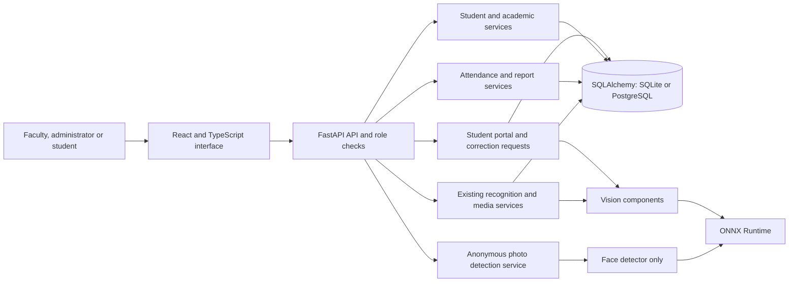
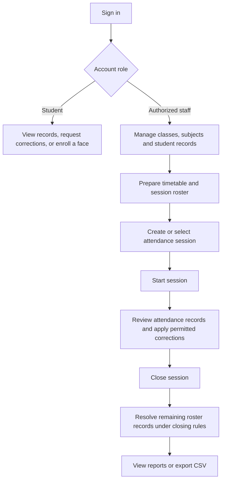
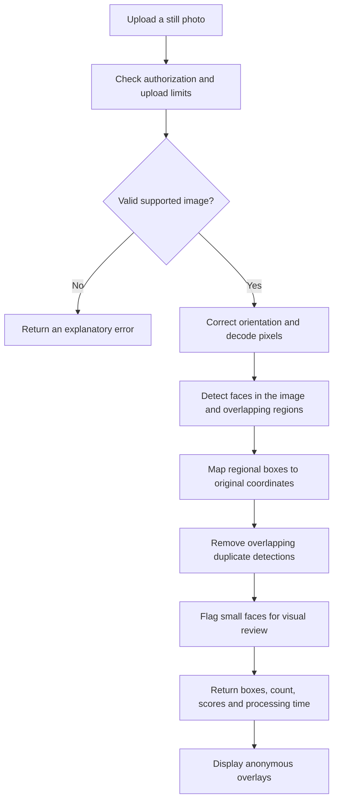
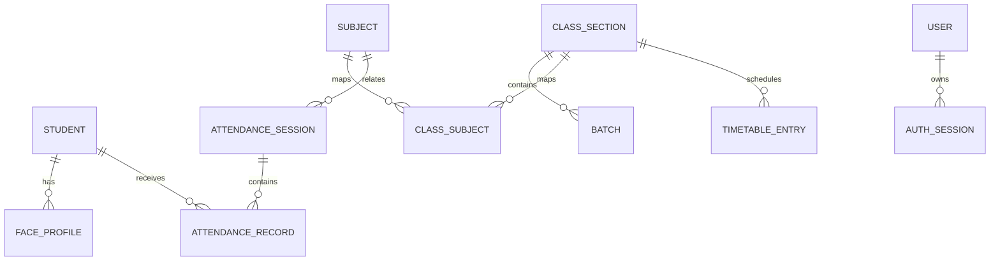
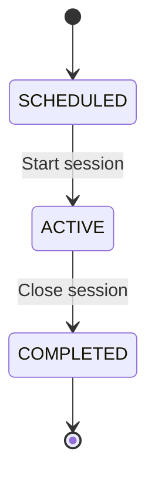

# AttedDEL

AttedDEL is an attendance management workspace for students, faculty, operators, and administrators. It brings together class schedules, student records, attendance sessions, reports, and camera diagnostics in a responsive React interface backed by FastAPI.

The repository is named **SAMS**. Use the **`joyson` branch** for the current application and UI updates. The separate legacy `attendance_app` remains for compatibility and regression coverage.

## Workspace overview

- **Dashboard:** attendance summaries, daily classes, recent activity and system health. Administrators can create an HOD account from **Users** by entering the department name as it appears on an existing class. HODs see the class, active student, and active session counts for their assigned department.
- **Student portal:** personal details, subject and date filters, an attendance target calculator, correction requests, face enrollment, and a face-match check.
- **Attendance sessions:** scheduling, session records, roster review and manual attendance. Assign classes to Faculty accounts under **Users → Manage → Assigned classes**. Faculty can work with sessions linked to one of their assigned classes. An administrator can handle older sessions without a linked class.
- **Students and academics:** student directory, classes, subjects, batches and timetable management. Administrators manage the academic setup and can preview and import CSV or Excel rosters from **Students**. Faculty read the timetable, class details, batches, and subject mappings for their assigned classes.
- **Reports:** attendance analytics with date, subject, and class filters, plus CSV, Excel, and printable PDF exports. Faculty reports and exports cover assigned classes. Faculty sign-in opens Attendance Sessions.
- **Anonymous detection:** upload a photo to locate visible faces without matching identities or recording attendance.
- **Interface:** light and dark themes, compact desktop navigation, responsive tables, keyboard focus states and mobile navigation.

The app also contains enrollment, recognition and photo-review workflows. Detection counts and similarity scores should not be treated as proof of identity or classroom-wide accuracy.

## Contents

- [Technology](#technology)
- [System architecture](#system-architecture)
- [Project workflow](#project-workflow)
- [Student portal and face enrollment](#student-portal-and-face-enrollment)
- [AI models and their responsibilities](#ai-models-and-their-responsibilities)
- [Machine-learning concepts](#machine-learning-concepts)
- [Algorithms and image processing](#algorithms-and-image-processing)
- [Database and attendance logic](#database-and-attendance-logic)
- [Evaluation and limitations](#evaluation-and-limitations)
- [Run on your laptop](#run-on-your-laptop)
- [Anonymous photo detection](#anonymous-photo-detection)
- [Verification commands](#verification-commands)
- [Configuration and operations](#configuration-and-operations)
- [API](#api)
- [Repository guide](#repository-guide)
- [Claude project handoff](docs/CLAUDE-HANDOFF.md)
- [Technical references](#technical-references)

## Technology

| Layer | Stack |
| --- | --- |
| Interface | React 18, TypeScript, Vite, Tailwind CSS, Lucide icons, Inter |
| API | Python, FastAPI, SQLAlchemy |
| Storage | SQLite for local development; PostgreSQL support |
| Vision | InsightFace buffalo_l, ONNX Runtime, OpenCV, Pillow |

## System architecture

AttedDEL has three main application layers. React presents records and captures user actions. FastAPI authenticates requests and coordinates services. SQLAlchemy reads and writes persistent records. Vision processing is a separate group of Python components called by selected services.



The anonymous diagnostic path does not query student profiles or write attendance. Other application services have their own persistence rules; a single diagram should not imply that every image request records attendance.

### Application layers

| Layer | Responsibility | Main source |
| --- | --- | --- |
| Presentation | Navigation, forms, tables, image overlays, light/dark themes | [`frontend/src/`](frontend/src/) |
| API boundary | Request validation, authentication, role checks and response schemas | [`backend/app/api/v1/`](backend/app/api/v1/) |
| Business services | Session lifecycle, academic records, manual updates and reports | [`backend/app/services/`](backend/app/services/) |
| Persistence | Entities, relationships, constraints and transactions | [`backend/app/models/entities.py`](backend/app/models/entities.py) |
| Vision | Detection, geometric processing, feature extraction and tracking components | [`ai_engine/`](ai_engine/) |

Runtime state and database state are different. Stream trackers, temporary observation buffers and the in-memory gallery are process-local. Student records and attendance records are stored in the database. Restarting a process clears temporary state; it does not erase the database.

## Project workflow

### Administrative flowchart



The timetable describes when a class is scheduled. A session represents an actual attendance event. A record connects one student to one session. These are separate objects: editing a timetable entry is not equivalent to marking a student present.

### Anonymous image analysis flowchart



No detection is a possible valid result. A face box means the detector found a face-like region; it does not establish identity, presence for an entire lecture, or the total number of occupants.

## Student portal and face enrollment

Open **Portal sign in** and enter a username, email, or Student User ID. The same form handles every role. A student account must be linked to a student record by an administrator under **Users**. An existing `/student-login` bookmark opens the shared sign-in page.

- **My details** displays the roster fields available for the linked record. The API masks the middle four digits of a ten-digit mobile number. The local Comp B roster uses Student User ID prefixes `124` and `224` for its academic-year ranges and displays Current Semester VI.
- **My attendance** filters recorded sessions by subject and dates. The target calculator uses the selected records and estimates how many consecutive future sessions the student needs to attend. Present, late, and manual-present marks count as attended.
- **Attendance corrections** start from a student's own session history. Administrators review requests under **Users → Student requests**. An approved correction applies an audited manual override.
- **Face registration** starts directly from the linked student account. Auto-capture waits for one second of a valid pose, saves it, and advances to the next required pose. Manual capture and JPEG upload are also available. The first accepted photo establishes the account's initial face template. Later photos must match a saved template.
- **Check face match** compares a front-facing capture with the signed-in student's saved templates and returns a match or no match. It does not write an attendance record.
- **Admin face enrollment** uses the same server-side pose validation. **Remove face data** clears a selected student's saved face profiles and pending legacy face photos, resets their enrollment status, and refreshes the gallery. Attendance records and the student account are retained.

First-time self-enrollment relies on the authenticated student account. Use strong, unique credentials before exposing the portal to students over a network. A password derived from a Student User ID permits anyone who knows that ID to sign in and establish the initial face template. Face comparison on a still photo does not establish liveness.

## AI models and their responsibilities

**`buffalo_l` is a pretrained InsightFace model package**, rather than a model trained from scratch by this repository. Its upstream model listing describes a SCRFD detector and a ResNet-50 recognition model. The implementation loads detection through InsightFace and the `w600k_r50.onnx` recognition file through ONNX Runtime. See the [upstream model zoo](https://github.com/deepinsight/insightface/blob/master/model_zoo/README.md).

| Component | What it produces | What it does not establish |
| --- | --- | --- |
| SCRFD face detector | Bounding boxes, detection scores and facial landmarks | A person's name or attendance status |
| ArcFace-style ResNet-50 embedding model | A 512-dimensional numeric representation | A calibrated probability of identity |
| ONNX Runtime | Execution of exported neural-network graphs | Training, a dataset or a recognition algorithm by itself |
| Local tracker | Temporary track IDs across frames | Permanent identities or guaranteed tracking through occlusion |
| Quality and texture checks | Measurements and rule-based decisions | Validated spoof resistance |

The detector implementation is in [`scrfd.py`](ai_engine/detection/scrfd.py), and the embedding wrapper is in [`arcface.py`](ai_engine/recognition/arcface.py). Model availability and the actual runtime provider should be inspected locally; CUDA support in code does not mean GPU inference was tested on every installation.

### Training versus inference

- **Training** adjusts neural-network weights using a dataset and a loss function. This repository does not contain a documented end-to-end training experiment for the supplied models.
- **Inference** runs already-trained weights on new images. This is the neural-network operation performed by the application.
- **Enrollment** stores reference information associated with an application record. Adding reference samples does not retrain the network or change its weights.
- **Configuration** changes application behavior. A threshold change is not model training and does not, on its own, prove improved accuracy.

## Machine-learning concepts

### Convolutional neural networks and residual learning

A convolutional neural network learns spatial patterns in images. Early layers can represent local edges or textures; later layers combine information into more abstract features. A ResNet adds shortcut connections around groups of layers. Those connections make deep networks easier to optimize during their original training. In this project, the resulting trained network is loaded for inference.

### Representation learning and embeddings

An embedding maps an image into a vector space. Images with related visual identity information are intended to have nearby representations. The vector's individual coordinates are learned features; they are not a list of named traits such as eye color or age.

The local wrapper returns a **512-dimensional vector**. This dimension is a property of the model output, not a count of students or facial landmarks. Embeddings remain sensitive biometric information; representing a face with numbers does not make that information anonymous or automatically irreversible.

### ArcFace and metric learning

ArcFace is an approach to training discriminative face representations using an angular margin in the classification objective. Its purpose is to improve separation between identities in the learned representation space. The application consumes pretrained representations; it does not calculate the ArcFace training loss during ordinary requests. See the [ArcFace paper](https://arxiv.org/abs/1801.07698).

### Vector normalization and similarity

The implementation uses L2 normalization, which rescales a vector to unit length:

$$
\hat{x} = \frac{x}{\lVert x\rVert_2}
$$

Cosine similarity compares vector directions:

$$
\operatorname{cosine}(x,y)=\frac{x^T y}{\lVert x\rVert_2\lVert y\rVert_2}
$$

For normalized vectors, this is a dot product. Similarity, detection confidence, quality scores and attendance percentages answer different questions and should not be compared as if they were the same measure. In particular, a similarity of `0.8` is not evidence of an 80% probability that an identity is correct.

### Open-set decisions and uncertainty

A real image can contain someone absent from a reference gallery. This is an **open-set** problem: the system needs an unknown outcome instead of always choosing the nearest stored entry. The repository includes known, uncertain/review and unknown decisions. It also considers ambiguity between leading candidates. These are application decision rules around model outputs, not additional neural-network classes learned for each enrolled student.

### Temporal information

One frame may be blurred or partially occluded. Temporal processing uses a sequence of observations rather than treating every frame as independent. The repository contains tracking, bounded observation histories and consistency checks. Repeated observations can still repeat the same error, so temporal agreement is not a guarantee of correctness.

## Algorithms and image processing

The following describes the components present in the code. Some are learned models; others are numerical algorithms or ordinary application rules.

| Algorithm or technique | Purpose | Source |
| --- | --- | --- |
| Face detection | Locate candidate facial regions | [`scrfd.py`](ai_engine/detection/scrfd.py) |
| Intersection over Union (IoU) | Measure overlap between two bounding boxes | [`base.py`](ai_engine/base.py) |
| Non-maximum suppression (NMS) | Suppress overlapping detections of the same region | [`scrfd.py`](ai_engine/detection/scrfd.py) |
| Overlapping photo regions | Analyze local image regions and translate their coordinates back | [`photo.py`](ai_engine/detection/photo.py) |
| Similarity transformation | Align landmarks using scale, rotation and translation | [`face_aligner.py`](ai_engine/alignment/face_aligner.py) |
| Laplacian variance | Estimate sharpness from image intensity changes | [`quality_analyzer.py`](ai_engine/quality/quality_analyzer.py) |
| Mean grayscale intensity | Measure approximate brightness | [`quality_analyzer.py`](ai_engine/quality/quality_analyzer.py) |
| Landmark geometry | Estimate approximate head pose | [`pose_estimator.py`](ai_engine/quality/pose_estimator.py) |
| Dense vector comparison | Compare representations in the in-memory gallery | [`vector_matcher.py`](ai_engine/recognition/vector_matcher.py) |
| Kalman filtering | Predict box position/state between observations | [`kalman_filter.py`](ai_engine/tracking/kalman_filter.py) |
| Linear assignment | Associate detections with predicted tracks | [`byte_tracker.py`](ai_engine/tracking/byte_tracker.py) |
| Sliding-window aggregation | Summarize recent observations for each track | [`temporal_verifier.py`](ai_engine/verification/temporal_verifier.py) |

### Bounding boxes, IoU and duplicate suppression

A box is represented by its upper-left and lower-right coordinates. IoU is the intersection area divided by the union area:

$$
\operatorname{IoU}(A,B)=\frac{|A\cap B|}{|A\cup B|}
$$

NMS processes detections in confidence order and suppresses sufficiently overlapping alternatives. This is especially relevant when overlapping photo regions report the same face more than once. An unfortunate suppression can also hide a legitimate nearby detection; it is not a perfect person counter.

### Alignment and quality measurements

The alignment module uses five landmarks and an Umeyama-style similarity transform based on singular value decomposition. It produces a canonical **112 × 112** crop for the embedding model. This normalizes image geometry; it cannot reconstruct the hidden side of a face or recover detail absent from the source.

The quality analyzer evaluates properties such as blur, brightness and face size. Laplacian variance measures variation in image second derivatives: a heavily blurred region generally has fewer sharp changes. These are image-quality heuristics, not learned identity judgments. Different processing paths have different quality rules, so there is no single universal minimum size or acceptance threshold for the entire application.

### Tracking and temporal verification

The code contains a local **ByteTrack-style** tracker using Kalman box prediction, overlap costs and SciPy linear assignment. It separates detection confidence groups during association. This is a local implementation, not evidence that the original ByteTrack benchmark results apply here. The original method is described in the [ByteTrack paper](https://arxiv.org/abs/2110.06864).

Tracking state and observation buffers are scoped by session/camera context in the recognition service. A track ID is temporary and can change after loss or reset. The temporal verifier uses configurable windows and consistency conditions; describing every runtime as a fixed “3 of 5 frames” algorithm would be inaccurate.

### Texture checks and liveness limitations

The existing liveness modules use texture/frequency measurements, including Fourier analysis and Laplacian statistics, plus landmark-related checks. They are heuristic components, not a demonstrated defense against printed faces, screen replay, deepfakes or other presentation attacks. Enforcement depends on the caller and configuration; the presence of a liveness score does not mean every endpoint requires it.

### Concepts not demonstrated by this repository

The application should not be described as a newly trained foundation model, reinforcement-learning system, LLM application or online-learning system. The core inspected gallery matcher uses NumPy matrix operations; the presence of a `pgvector` dependency does not establish that an approximate vector index is used on that path. There is no evidence here of a locally measured, universal classroom recognition accuracy or latency figure.

## Database and attendance logic



This is a simplified relationship diagram; optional foreign keys and all auxiliary tables are defined in [`entities.py`](backend/app/models/entities.py).

| Entity | Meaning |
| --- | --- |
| `User` / `AuthSession` | Login identity, role and authentication session |
| `Student` | Student directory record; separate from a login account |
| `UserStudentLink` | Explicit link used for a student's personal attendance view |
| `FaceProfile` | Stored reference representation and related metadata |
| `ClassSection`, `Batch`, `Subject` | Academic organization |
| `TimetableEntry` | Planned class slot |
| `AttendanceSession` | Scheduled or active attendance event |
| `AttendanceRecord` | Student status for one session |
| `AuditLog` | Application audit event; not inherently tamper-proof storage |

### Session lifecycle and consistency



The diagram shows the ordinary start/close path. Additional states and permitted actions depend on the API. Closing a session resolves remaining roster entries under the attendance service's rules and prevents further active-session capture operations.

Attendance deduplication is a database concern as well as an application concern. The schema has a unique constraint on `(session_id, student_id)`, preventing multiple rows for that pair. A row can still be updated: one stored record does not mean an immutable event history. Manual corrections record their source and generate an audit action. Detailed transition rules differ between manual, live and reviewed-photo paths.

Authentication uses password hashing and bearer tokens with refresh-session handling. Role checks control staff endpoints. Authorization, roster membership and session state must be evaluated separately from image scores: none of those business rules are learned by the vision model.

## Evaluation and limitations

**A successful build or passing integration test proves a software behavior, not model accuracy in a classroom.** Model evaluation needs labelled, representative data and clear definitions of what counts as success.

| Measure | Question it answers |
| --- | --- |
| Detection precision | Of the reported face boxes, how many are correct? |
| Detection recall | Of the visible faces in the labelled images, how many were found? |
| False acceptance / false rejection | How often does an identity decision incorrectly accept or reject? |
| Unknown-person rejection | How does the system behave when a person is absent from the gallery? |
| Track stability | Does a track remain consistent across a sequence? |
| Latency | How long do decoding, inference and the full request take on specified hardware? |

No representative classroom benchmark for these measures is included in this README. Results from upstream model datasets cannot be copied as this project's measured accuracy. A speed report needs hardware, input resolution, face count, runtime provider and cold/warm model state.

Current practical limits include small or occluded faces, backlighting, motion blur, changing camera angles, track loss and limited image detail. Upscaling cannot create missing visual information. A photograph of the back of a person's head does not supply a visible face. Basic texture checks do not establish anti-proxy guarantees.

Operational limits also matter: SQLite has write-concurrency constraints, phone capture requires a trusted browser camera context, and in-memory stream state requires deliberate deployment design. See the configuration section and manual QA notes for the supported local workflow.

## Run on your laptop

Install Python 3.11–3.13 (3.11 tested), or Python plus uv; install Node.js 20+ and npm. Clone the current application branch:

```bash
git clone --branch joyson https://github.com/Joyson01/SAMS.git
cd SAMS
```

From the repository root, start the app:

```bash
./start.sh
```

On Windows run `start.bat`. The launcher creates `.venv-attedel`, installs backend/frontend dependencies, creates `.env` if absent, initializes the database through startup and starts both services. Open **http://localhost:5173**. API docs: **http://localhost:8000/api/v1/docs**. Ctrl+C stops both services. Existing `.env` is preserved. Busy ports produce an error rather than killing another process.

The standard launcher enables authentication even if a previous local session used login bypass. Initial dependency installation and model loading can take longer than later starts.

An empty development database gets **admin / Admin@12345**. Change that password in Users immediately; resetting a password revokes sessions. Alternative first-admin methods: `/setup` or, inside the app virtual environment, `python -m scripts.create_admin`. Setup works only while no ADMIN exists; outside development it also requires BOOTSTRAP_TOKEN. No development account is seeded in production, and the default development administrator password is rejected there.

Create a class/subject in Courses & Rooms, add students, then select Enroll on your student. Complete the guided poses and open Recognition Test. Live Attendance lets you create/select a session and use the built-in webcam without registering a separate camera. Finish marks unrecorded roster members absent. Reports exports CSV. Student accounts use My Attendance after an administrator links their roll number and student code.

## Anonymous photo detection

Sign in as an administrator or faculty member, then choose **Recognition tools → Anonymous Detection**, or open `/anonymous-detection`.

1. Upload an original still JPEG, PNG or WebP photo.
2. Review the face boxes and count. Dashed boxes mark small faces that need visual review.
3. Upload another image to repeat the check. The page shows progress and clears old results when a new upload fails.

Uploads are limited to **15 MB**, **24 megapixels**, and **8000 pixels per side**. Animated images are rejected. Image orientation is corrected before detection. This mode returns locations and detection scores; it does not read the student gallery, generate recognition embeddings, or save attendance.

The count represents detected visible faces, not everyone in the room. Small, covered or turned-away faces can be missed. A back-row example returned six boxes including the previously missed face; that is a single-image check, not an accuracy benchmark.

## Functionality and validation notes

- Public student registration, login, refresh rotation, logout invalidation, bootstrap restrictions, staff account management and student record linking.
- Shared sign-in, linked student profiles, direct guided face enrollment, account-scoped face matching, and audited attendance correction review. The student-portal integration test exercises these API paths with simulated embeddings.
- Academic CRUD, batch management, class-subject mapping, timetable editing and an idempotent academic-only demo seeder.
- Server-validated face quality/pose checks, duplicate identity rejection at 0.80, pose retakes, SQL embedding persistence and automatic runtime gallery updates.
- Read-only Recognition Test with live/uploaded images, mirrored boxes, similarity and top candidates, gallery/latency stats and development controls.
- Real-image temporal attendance confirmation, session isolation/cleanup, one record per student/session, closure rejection and absent population.
- Photo preview/review/confirmation, margin buckets, one-to-one selection, idempotency and protection of MANUAL_PRESENT/EXCUSED.
- Linux startup from a clean source snapshot, frontend TypeScript/build, HTTP smoke and Chromium fake-camera flow.

The original recognition smoke tests configured **FRONT only** on disposable servers. Later Chromium checks exercised seven-pose student capture and progression with a simulated camera and mocked pose responses. Physical webcam behavior, real-person matching, Windows/macOS startup, direct capture on physical phones, PostgreSQL, and CUDA still require validation. See [manual QA](docs/MANUAL_QA.md), [troubleshooting](docs/TROUBLESHOOTING.md), [audit](docs/AUDIT.md) and [final verification report](docs/FINAL_REPORT.md).

For the November 16, 2026 updates, the anonymous detection and photo-detector checks passed (14 tests). The frontend production build passed after UI polishing. Browser checks covered navigation, directory search, dialog controls, desktop and phone layouts, dark mode and keyboard focus. These are scoped results, not a new full-suite certification. See the [UI polish report](docs/UNSLOP_DIRECTION.md) and [anonymous detection design](docs/anonymous-detection-design.md).

See the [go-live checklist and staff manual](docs/GO_LIVE.md) for pilot acceptance, recovery, and deployment checks.

## Verification commands

```bash
# After activating .venv-attedel (or the verification environment)
python -m pytest -q
python -m scripts.check_models
python -m scripts.smoke_test
cd frontend && npm run build
```

`smoke_test` starts its own disposable SQLite/server environment, uses two different faces from InsightFace t1, checks enrollment/matching/UNKNOWN, temporal attendance, closure, final statuses and CSV, then stops the server. The recorded run reached PRESENT in **1.39 seconds**. This does not establish accuracy or latency on your webcam.

Optional browser verification (requires ffmpeg and Playwright test tooling):

```bash
python -m pip install playwright
python -m playwright install chromium
python -m scripts.browser_smoke
```

It uses Chromium's fake-camera flags and a real fixture image; it never opens hardware. Results: [HTTP](docs/SMOKE_RESULT.json), [browser](docs/BROWSER_RESULT.json). No lint command is configured. Current full-suite results and warnings are recorded in the final report rather than historical README test counts.

## Configuration and operations

See [.env.example](.env.example). SQLite uses `data/sams_dev.db`; PostgreSQL accepts a SQLAlchemy asyncpg URL. Configure a unique SECRET_KEY and BOOTSTRAP_TOKEN before non-development setup. Enrollment poses are configured by ENROLLMENT_REQUIRED_POSES. Default: FRONT, LEFT_15, RIGHT_15, TILT_UP, TILT_DOWN, ROLL_RIGHT, BACKUP_FRONT. The pose estimator is approximate.

Compose requires `POSTGRES_PASSWORD` and a unique `SECRET_KEY`. Set `BACKEND_CORS_ORIGINS` to a JSON list if the frontend runs on a separate origin. Compose disables the SQLite fallback. Use the local startup scripts for development.

For a **new, empty database**, export its async SQLAlchemy `DATABASE_URL` and run these commands from the repository root before starting the app:

```bash
python -m scripts.bootstrap_database
python -m alembic -c backend/alembic.ini current
python -m alembic -c backend/alembic.ini check
```

The bootstrap creates the current schema and records its Alembic revision in one transaction. It refuses databases with existing tables or views. The historical upgrade path from earlier revisions still needs repair and verification. PostgreSQL bootstrap has not been verified against a running PostgreSQL server.

In production, login, live frame analysis, photo inference, and video submission have separate per-IP limits shared across the API aliases. A throttled request returns HTTP 429 with a `Retry-After` header. Compose keeps the backend on its internal network and Nginx replaces incoming forwarded-client headers. For other reverse proxies, trust only the proxy that sets the client IP. Clients behind a shared IP share each quota. The limits apply to HTTP and are stored in the backend worker’s memory.

InsightFace model files live in `~/.insightface/models/buffalo_l`. `python -m scripts.check_models` prints real face counts, 512-value embedding shapes and runtime providers, or manual-install instructions. `/health` reports database and AI availability without requiring login. Use **one backend worker**; the recognition gallery and stream state are in memory.

`python -m scripts.seed_demo_data` optionally adds fictional academic records, idempotently, without embeddings or attendance. It is not required for the real workflow. `./start.sh --check` starts both services, verifies HTTP readiness, then stops them. Export BACKEND_PORT/FRONTEND_PORT for alternate ports. Optional `npm run dev:https` supports HTTPS development; actual phone trust/setup remains manual.

Cosine similarity is not probability. Basic liveness does not establish robust spoof resistance. Use the reviewed/manual attendance flow when identity is uncertain.

## API

Canonical prefix: `/api/v1`; `/api` is a compatibility alias. Auth uses bearer tokens with revocable refresh sessions. Staff APIs reject student accounts. Recognition Test is ADMIN/FACULTY; Users is ADMIN.

- Auth: `/auth/register`, `/auth/login`, `/auth/refresh`, `/auth/logout`, `/auth/me`, `/auth/setup-status`, `/auth/bootstrap-admin`, `/auth/users`, `/auth/users/{id}/student`, `/auth/my-attendance`.
- Students: `/students`, `/students/{id}`, `/students/{id}/enroll`, `/students/{id}/enroll/check`, `/students/{id}/enroll/status`.
- Student portal: `/student-portal/requests`, `/student-portal/corrections`, `/student-portal/face/check` (pose guidance), `/student-portal/face` (save), `/student-portal/face/match` (compare), and admin `/student-portal/review`.
- Academics: `/classes`, `/subjects`, `/classes/{id}/batches`, `/classes/{id}/subjects`, `/classes/{id}/timetable`, `/classes/timetable/entries`.
- Recognition: `/recognition/analyze-frame` (no writes), `/recognition/process` (active-session attendance), `/recognition/config`, `/recognition/thresholds`.
- Anonymous detection: `POST /detection/photo`, multipart field `file`; ADMIN/FACULTY only. Returns frame dimensions, face boxes, detection scores, small-face flags, count and latency.
- Attendance: `/attendance/sessions`, session `/start`, `/close`, `/records`, `/roster`, plus `/attendance/manual`.
- Photo review: `/media-attendance/image/preview`, `/media-attendance/image/confirm`.
- Reports/health: `/reports/analytics`, `/reports/export/csv`, `/health`.

See the generated [API inventory](docs/API_ROUTES.md) or live OpenAPI docs for exact methods. Direct device capture uses the browser camera. Previous RTSP and cross-device pairing URLs have been retired.

## Repository guide

| Path | Purpose |
| --- | --- |
| `frontend/src/` | Application pages, shared controls, styling and API clients |
| `backend/app/` | FastAPI routes, services, data models and configuration |
| `ai_engine/` | Vision components |
| `scripts/` | Startup, setup and diagnostic utilities |
| `tests/` | Unit and integration checks |
| `docs/` | Setup guides, design decisions and validation reports |

Keep local `.env` files, database backups, student images and runtime logs out of commits. The application data in a local checkout is not supplied by cloning this repository.

## Technical references

These references explain the underlying methods. Their research results are not performance measurements of this application.

- [InsightFace model zoo](https://github.com/deepinsight/insightface/blob/master/model_zoo/README.md) — upstream model packages and model descriptions.
- [ArcFace: Additive Angular Margin Loss for Deep Face Recognition](https://arxiv.org/abs/1801.07698) — the representation-learning objective associated with ArcFace.
- [ByteTrack: Multi-Object Tracking by Associating Every Detection Box](https://arxiv.org/abs/2110.06864) — the tracking approach that informs the local tracker.
- [Face-processing orchestration](ai_engine/pipeline/face_pipeline.py) — actual component invocation and optional checks in this repository.
- [Recognition service](backend/app/services/recognition_service.py) — runtime configuration and stream-state ownership.
- [Anonymous detection service](backend/app/services/anonymous_detection.py) — isolated detection-only request processing.
- [Attendance service](backend/app/services/attendance_service.py) — session closure, record updates and manual corrections.
- [UI direction and validation](docs/UNSLOP_DIRECTION.md) — design decisions and the scope of browser checks.

Documentation describes the inspected `joyson` application as of November 16, 2026. Configuration and source code take precedence over illustrative diagrams; older reports describe their own recorded runs.
